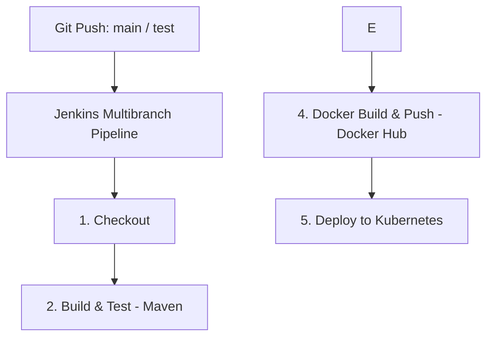

# 🚀 End-to-End DevOps Java Application

A Java 17 / Spring Boot application delivered through a fully automated **Jenkins Multibranch CI/CD pipeline**: built and tested with Maven,containerized with Docker, and deployed to Kubernetes.

## 🛠️ Tech Stack

| Area | Tools |
|---|---|
| Application | Java 17, Spring Boot, Maven |
| CI/CD | Jenkins (Multibranch Pipeline) |
| Containerization | Docker, Docker Hub |
| Orchestration | Kubernetes (Deployments, Pods, Services) |
| Version Control | Git, GitHub |

## 🏗️ Architecture & Pipeline Flow



Images are tagged with the **build number** (e.g. `adhamgamal74/java-app:v1.0-${BUILD_NUMBER}`) so every deployment is traceable and rollbacks are straightforward.

## 🌿 Branching Strategy

| Branch | Purpose | Deployment Target |
|---|---|---|
| `main` | Production-ready code | Production namespace |
| `test` | Staging & feature testing | Staging namespace |

## ☸️ Kubernetes Configuration

- **Deployment:** 4 replicas for load distribution and zero-downtime rolling updates.
- **Service:** `<NodePort>` exposing the app on port `8082`.
- **Namespaces:** separate namespaces per branch (`production`, `staging`).

## 🚦 Quick Start

### Prerequisites
- Java 17+ and Maven
- Docker Desktop / Engine
- Minikube or any Kubernetes cluster with `kubectl` configured
- Helm 3 (optional)

### Run locally with Docker
```bash
docker build -t adhamgamal74/java-app:v1.0-${BUILD_NUMBER} .
docker run -d -p 8082:8080 adhamgamal74/java-app:v1.0-${BUILD_NUMBER}
```
The app is available at http://localhost:8082.

### Deploy to Kubernetes
```bash
kubectl apply -f deploy.yml
kubectl apply -f service.yml
kubectl get pods
kubectl get svc
```

On Minikube, open the service with:
```bash
minikube service <service-name>
```


## ⚙️ CI/CD Setup

Configure these in Jenkins before running the pipeline:

| Credential ID | Type | Used for |
|---|---|---|
| `dockerhub-creds` | Username/Password | Pushing images to Docker Hub |

## 👤 Author

**Adham Gamal**:  [LinkedIn](https://linkedin.com/in/adhamgamal74)
