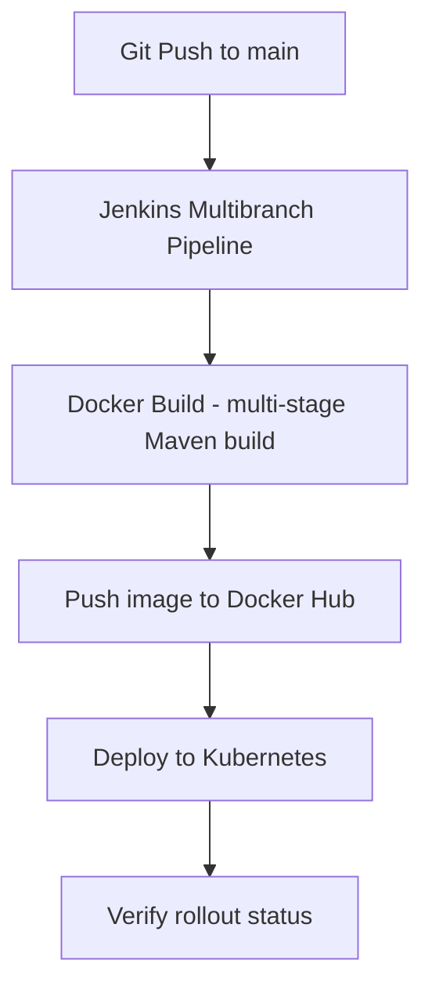

# 🚀 End-to-End DevOps Java Application

A CI/CD pipeline built with **Jenkins (Multibranch)** that packages a Java 17 / Spring Boot application into a Docker image using a multi-stage build, pushes it to Docker Hub, and deploys it to Kubernetes.

> **Note:** The application code is an open-source project ([original repo](ORIGINAL_REPO_LINK), credit to its authors). My work is the DevOps layer: `Dockerfile`, `Jenkinsfile`, `deploy.yml`, and `service.yml`.

## 🛠️ Tech Stack

| Area | Tools |
|---|---|
| Application | Java 17, Spring Boot, Maven |
| CI/CD | Jenkins (Multibranch Pipeline) |
| Containerization | Docker (multi-stage build), Docker Hub |
| Orchestration | Kubernetes (Deployment, NodePort Service) |
| Version Control | Git, GitHub |

## 🏗️ Pipeline Flow



Images are tagged `v1.0-<BUILD_NUMBER>` (e.g. `adhamgamal74/java-app:v1.0-12`) so every deployment is traceable. The build, push, and deploy stages run on the `main` branch.

## ☸️ Kubernetes Configuration

- **Deployment:** `my-app1-deployment` with 4 replicas and rolling updates.
- **Service:** NodePort exposing the app on port `8082`.

## 🚦 Quick Start

### Prerequisites
- Docker Desktop / Engine
- Minikube or any Kubernetes cluster with `kubectl` configured

### Run locally with Docker
```bash
docker build -t adhamgamal74/java-app:local .
docker run -d -p 8082:8082 adhamgamal74/java-app:local
```
The app is available at http://localhost:8082.

### Deploy to Kubernetes
```bash
kubectl apply -f deploy.yml
kubectl apply -f service.yml
kubectl get pods
kubectl get svc
```

On Minikube, open the service with:
```bash
minikube service <service-name>
```

## ⚙️ CI/CD Setup

Configure these credentials in Jenkins before running the pipeline:

| Credential ID | Type | Used for |
|---|---|---|
| `dockerhub` | Username/Password | Pushing images to Docker Hub |
| `kubeconfig` | Secret file | `kubectl` access to the cluster |


## 👤 Author

**Adham Gamal**: [LinkedIn](https://linkedin.com/in/adhamgamal74)
